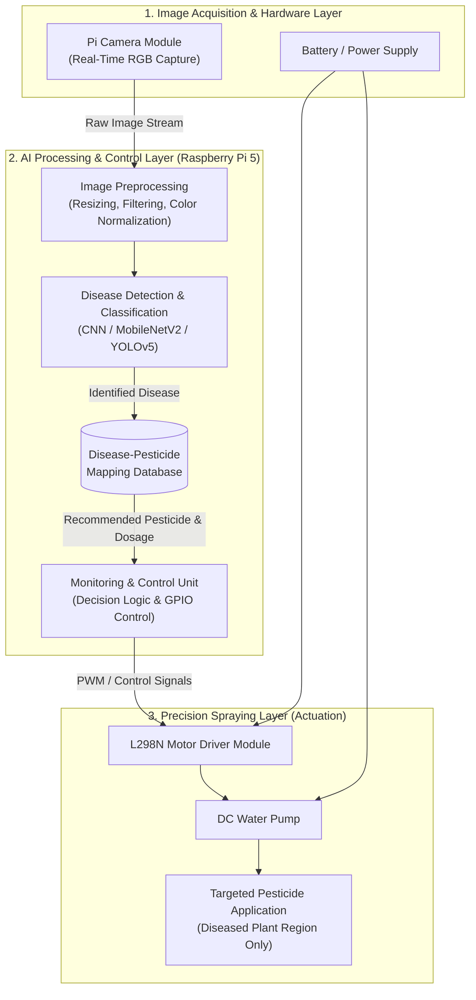
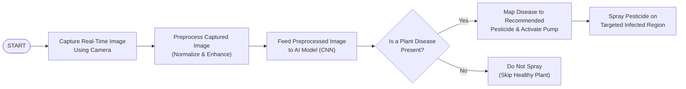

# AI-Based Precision Sprayer for Targeted Diseased Plants Management

[-blue)](./IJIRE.pdf)
[](https://www.doi.org/10.59256/ijire.20260703030)
[](http://creativecommons.org/licenses/by/4.0/)

> **Academic Research & Engineering Project Repository**  
> **Research Paper:** [AI Based Precision Sprayer for Targeted Diseased Plants Management (`IJIRE.pdf`)](./IJIRE.pdf)  
> **Published In:** *International Journal of Innovative Research in Engineering (IJIRE)*, Volume 7, Issue 3 (May–June 2026), PP: 292–298, ISSN: 2582-8746.

---

## Table of Contents
1. [Project Overview](#1-project-overview)
2. [Problem Statement](#2-problem-statement)
3. [Objectives](#3-objectives)
4. [System Architecture](#4-system-architecture)
5. [Hardware & Software Requirements](#5-hardware--software-requirements)
6. [Methodology](#6-methodology)
7. [Experimental Results & Discussions](#7-experimental-results--discussions)
8. [Advantages & Applications](#8-advantages--applications)
9. [Conclusion](#9-conclusion)
10. [Citation & Publication Details](#10-citation--publication-details)

---

## 1. Project Overview

Agriculture plays a vital role in sustaining the global economy and ensuring food security. However, plant diseases caused by pathogens such as fungi, bacteria, and viruses drastically reduce crop yields, degrade quality, and increase cultivation costs. Conventional disease management relies heavily on uniform, blanket chemical spraying across entire fields regardless of the actual health status of individual plants.

The **AI-Based Precision Sprayer for Targeted Diseased Plants Management** integrates **Artificial Intelligence (AI)**, **Computer Vision**, **Deep Learning (Convolutional Neural Networks)**, and **Automated Spraying Actuation** to modernize crop protection. Using a real-time camera module, the system continuously scans crops to detect visual symptoms of infection on leaves and stems (such as leaf spots, discoloration, blight, and mildew). Once a disease is identified and classified via a pre-trained deep learning model, the system queries a **disease-to-pesticide mapping database** to select the appropriate treatment and triggers an electronically controlled precision sprayer to apply pesticide **exclusively to the affected plant areas**.

By ensuring that chemical inputs are applied in the right place, in the right amount, and at the right time, this system significantly reduces chemical wastage, lowers operational costs for farmers, prevents soil and water contamination, preserves healthy plants and biodiversity, and mitigates the development of pesticide-resistant pathogen strains.

---

## 2. Problem Statement

Modern agriculture relies extensively on chemical pesticides to protect crops from diseases and pests, yet conventional application practices present severe operational, economic, and ecological challenges:

### Limitations of Existing Systems
Traditional pesticide application relies predominantly on manual or semi-automated techniques such as knapsack sprayers, tractor-mounted boom sprayers, and hydraulic sprayers:
- **Inefficiency and Chemical Waste:** Uniform blanket spraying distributes chemicals across entire fields regardless of plant health status, exposing healthy plants and non-target areas to unnecessary agrochemicals and inflating input costs.
- **Environmental and Health Hazards:** Over-application accelerates soil fertility degradation, contaminates groundwater and surface waterways via chemical runoff, disrupts local ecosystems, harms beneficial insects and pollinators, and exposes farmers and consumers to chemical residues.
- **Pesticide Resistance:** Indiscriminate and inconsistent application risks under-treating active disease hotspots while over-treating healthy zones, accelerating the evolution of resistant pest and pathogen strains.
- **Delayed Detection and Labor Intensity:** Manual scouting and visual inspection are time-consuming, labor-intensive, unscalable for modern farms, and prone to human error. Consequently, infections often go unnoticed until visual symptoms become severe, leading to substantial yield losses.

Therefore, there is an urgent need for an automated, real-time system capable of accurately detecting diseased crop regions in the field and administering targeted pesticide treatments to minimize chemical usage, reduce costs, and support sustainable agricultural production.

---

## 3. Objectives

- **Develop a Real-Time AI Plant Disease Detection Framework:** Utilize advanced image processing and deep learning algorithms (CNNs) to accurately distinguish between healthy and diseased plants directly under field conditions.
- **Design a Targeted Precision Spraying Mechanism:** Construct an automated, electronically controlled fluid delivery system that dispenses pesticides exclusively onto detected diseased zones, minimizing chemical waste.
- **Implement a Disease-Pesticide Mapping Database:** Integrate a curated dataset that maps each classified plant disease to its most effective chemical treatment, ensuring timely and accurate intervention.
- **Promote Environmentally Sustainable Agriculture:** Drastically reduce pesticide runoff, drift, and non-target chemical exposure to preserve soil health, water quality, and farm biodiversity.
- **Enhance Cost-Effectiveness and Farmer Productivity:** Lower operational expenses by reducing chemical consumption and manual labor requirements while improving crop yield and produce quality.
- **Ensure Scalability and Field Adaptability:** Provide a modular hardware and software architecture adaptable to diverse crop types, greenhouse setups, and open-field agricultural environments.

---

## 4. System Architecture

The system adopts a modular, multi-layered architecture designed for real-time identification and targeted treatment of diseased crops with minimal latency and high reliability.



### Functional Layers
1. **Data Acquisition Layer:** High-resolution RGB or multispectral cameras (such as the Raspberry Pi Camera Module mounted on field equipment, tractors, drones, or fixed stations) continuously capture images or video streams of plant leaves and stems.
2. **Preprocessing Layer:** Addresses field imaging challenges including variable illumination, complex backgrounds, and sensor noise. Techniques such as image resizing, filtering, color normalization, and data augmentation (rotation, flipping, scaling) standardize the raw frames prior to inference.
3. **Disease Detection Layer:** Leverages Convolutional Neural Networks (CNNs) and lightweight transfer learning architectures (e.g., **MobileNetV2**, **YOLOv5**) to extract spatial features, classify specific plant diseases, and isolate regions of interest with high accuracy and low latency.
4. **Spraying Control Layer:** Translates classification decisions and database recommendations into precise hardware actuations. Using GPIO control signals, motor drivers, and optionally GPS/sensor fusion, electronically controlled spray nozzles dispense the exact required dose onto affected areas.
5. **Data Management and Monitoring Layer:** Stores captured imagery, classification outcomes, spray activity logs, and environmental telemetry. Provides an intuitive dashboard for real-time status monitoring, alerts, remote access, and historical analytics.
6. **Feedback and Decision-Making Layer:** Continuously evaluates system performance using metrics such as accuracy, precision, recall, and F1-score. Flags abnormal detections and supports iterative model retraining with newly acquired field data across edge and local/cloud deployments.

---

## 5. Hardware & Software Requirements

### 5.1 Hardware Requirements

| Component | Specifications & Role in System |
| :--- | :--- |
| **Raspberry Pi 5** | **Central Processing & Control Unit:** Equipped with a 64-bit quad-core ARM Cortex-A76 processor. Executes image preprocessing, runs deep learning inference, hosts the local backend server and Eclipse Mosquitto MQTT broker for low-latency local network routing, and generates GPIO control signals. |
| **Pi Camera Module** | **Image Acquisition Sensor:** Continuously captures high-resolution real-time images and video frames of plant leaves and stems under field conditions to detect leaf spots, discoloration, blight, and mildew. |
| **DC Water Pump** | **Pesticide Delivery Mechanism:** Transfers liquid pesticide solution from the storage reservoir through the tubing and nozzle network upon activation to perform targeted spraying. |
| **Motor Driver Module (L298N)** | **Actuation Interface:** Acts as a power interface between the Raspberry Pi's low-power GPIO signals and the higher-power DC water pump. Regulates pump activation, speed (via PWM), and operating duration while providing electrical isolation and protection. |
| **Plastic Containers (Reservoir Tanks)** | Stores the pesticide/water solution prior to and during fluid transfer. |
| **Flexible PVC Tubes & Nozzles** | Connects the reservoir tanks and DC pump to deliver smooth, directed liquid flow onto the target plant area. |
| **Power Supply (Battery / Adapter)** | Supplies regulated electrical power to the Raspberry Pi 5, L298N motor driver module, and DC pump. |
| **Connecting Wires** | Jumper wires and cabling to establish reliable electrical and signal connections across all hardware modules. |

### 5.2 Software Requirements

| Software / Library | Purpose |
| :--- | :--- |
| **Raspberry Pi OS** | Linux-based operating system managing hardware resources and executing all runtime processes on the Raspberry Pi 5. |
| **Python** | Core programming language used to develop the image processing pipeline, deep learning inference engine, database lookup, and hardware control logic. |
| **OpenCV** | Computer vision library utilized for real-time camera frame acquisition, image resizing, noise filtering, and color space normalization. |
| **TensorFlow / Keras** | Deep learning frameworks used for building, training, optimizing, and deploying the Convolutional Neural Network (CNN) disease classification models. |
| **RPi.GPIO** | Python library used to interface with the Raspberry Pi GPIO pins for controlling the L298N motor driver and DC water pump. |
| **IDE / Editor (Thonny / VS Code)** | Development environments used for writing, editing, and debugging the embedded and ML codebases. |
| **Serial / Terminal Tools** | Command-line utilities used for system diagnostics, real-time log monitoring, and performance benchmarking. |

---

## 6. Methodology

### 6.1 End-to-End Operational Data Flow



1. **Real-Time Acquisition:** Cameras mounted on field equipment continuously capture images of crops.
2. **Preprocessing:** Raw frames undergo noise removal, resizing, normalization, and contrast enhancement to compensate for variable outdoor lighting and background interference.
3. **AI Disease Detection & Classification:** Preprocessed images are passed into the trained CNN model, which extracts visual pathology features and classifies the specific disease type.
4. **Database Mapping & Decision Logic:** When a disease is detected, the system cross-references its internal disease-pesticide mapping database to identify the recommended chemical treatment and determine whether spraying is required.
5. **Targeted Spraying Execution:** Control signals trigger the L298N motor driver and DC pump to activate spray nozzles solely over the infected plant region. If the plant is healthy, the sprayer remains off.
6. **Data Logging & Remote Monitoring:** Detection results, confidence scores, treatment recommendations, and pump actuation logs are recorded for operator review via an intuitive dashboard.

### 6.2 Machine Learning & System Development Pipeline

1. **Data Collection and Cleaning:** Extensive plant leaf image datasets are collected using high-resolution cameras and curated by removing blurry, noisy, corrupted, or irrelevant samples.
2. **Data Partitioning:** The cleaned dataset is randomly partitioned into **80% training** and **20% testing** subsets, separating input image features from target disease class labels for supervised learning and independent evaluation.
3. **Initial Model Training:** A baseline Convolutional Neural Network (CNN) or transfer learning architecture (e.g., **MobileNetV2**, **YOLOv5**) is trained on the extracted image features to establish benchmark classification metrics.
4. **Feature Engineering and Reduction:** Techniques including duplicate removal, variance thresholding, and correlation analysis are applied to prune redundant or non-informative features—reducing computational complexity, preventing overfitting, and accelerating inference on edge hardware.
5. **Model Retraining and Validation:** The model is retrained using the refined feature pipeline and validated against the 20% test set to verify improvements in accuracy, precision, recall, and F1-score.
6. **System Integration:** The optimized model is deployed onto the embedded computation unit integrated with the camera sensor, L298N motor driver, and DC water pump for autonomous real-time operation.
7. **Continuous Feedback and Improvement:** Real-time inference logs and field telemetry are continuously analyzed to fine-tune model parameters, incorporate new field samples, and adapt to evolving crop conditions.

---

## 7. Experimental Results & Discussions

A working hardware and software prototype of the **AI-Based Disease Detection and Precision Spraying System** was implemented and evaluated on live plant specimens (specifically focusing on tomato plant pathology):

- **Real-Time Tomato Disease Detection:** A camera captures live leaf imagery of a tomato plant, transmitting frames to the processing unit running the trained deep learning model.
- **Disease Identification & Confidence Scoring:** In experimental testing, the model accurately identified **Late Blight** on infected tomato leaves with a classification confidence of **83.9%**.
- **Automated Treatment Recommendation:** Cross-referencing the detected pathology with the integrated mapping database automatically recommended **Mefenoxam / Metalaxyl** as the targeted fungicide treatment along with application guidance.
- **Automated Pump Actuation:** Based on the positive disease detection and virtual/hardware pump decision logic (`ON`/`OFF`), the controller automatically signals the L298N driver circuit to activate the DC pump and dispense treatment strictly onto the diseased plant while remaining inactive (`OFF`) for healthy plants.

Compared to conventional uniform spraying, the prototype demonstrated substantial reductions in chemical wastage, low communication latency for immediate disease response, and reduced manual labor requirements.

---

## 8. Advantages & Applications

### 8.1 Key Advantages
1. **Targeted Spraying:** Dispenses pesticides strictly onto AI-identified diseased plant regions, drastically cutting chemical wastage.
2. **Reduced Environmental Impact:** Minimizes soil degradation, groundwater contamination, chemical drift, and harm to non-target beneficial organisms and pollinators.
3. **Cost Efficiency:** Lowers recurring expenditure on agrochemicals and reduces manual labor costs through automated scouting and spraying.
4. **Early Disease Detection:** Computer vision models identify subtle visual pathology symptoms early before infections spread across the entire field.
5. **Improved Crop Yield & Quality:** Preserves healthy plants from unnecessary chemical stress while halting disease progression, resulting in higher-quality produce.
6. **Automation & Labor Saving:** Operates autonomously for continuous monitoring and treatment, eliminating human error in visual inspection.
7. **Data-Driven Decision Making:** Logs plant health analytics and spray records, empowering farmers to make informed crop management decisions.
8. **Scalability & Adaptability:** Modular hardware and customizable disease-pesticide databases allow adaptation across diverse crop varieties and farm sizes.
9. **Real-Time Operation:** Edge-based processing ensures immediate detection and instant nozzle actuation in the field.
10. **Supports Sustainable Agriculture:** Aligns with global eco-friendly farming initiatives and food safety standards.

### 8.2 Practical Applications
- **Crop Disease Detection and Targeted Treatment:** Automated in-field identification and selective treatment of fungal, bacterial, and viral crop infections.
- **Smart Greenhouse Monitoring:** Continuous, autonomous surveillance and micro-dosing of plants within controlled indoor agricultural environments.
- **Field-Level Precision Spraying:** Integration with agricultural drones, tractor booms, or autonomous ground vehicles (UGVs) for large-scale farm operations.
- **Weed and Pest Control:** Differentiating between crops, weeds, and insect pests using computer vision to perform selective herbicide or insecticide spraying.
- **Nutrient Deficiency Detection:** Identifying foliar discoloration or stress caused by nutrient imbalances and applying targeted corrective foliar fertilizers.
- **Crop Health Mapping:** Generating digital spatial maps of disease hotspots and plant health distributions across fields for precision farm management.
- **Automated Farming & IoT Ecosystems:** Seamless integration with wireless sensor networks, MQTT brokers, cloud analytics, and agricultural robotics.
- **Agricultural Research & Development:** Supporting agronomists and researchers in studying disease progression, evaluating treatment efficacy, and developing sustainable crop protection strategies.

### 8.3 System Challenges & Operational Considerations
While highly effective, practical deployment considers the following engineering constraints:
- **Initial Hardware Investment:** High-resolution cameras, embedded processors, and automated sprayers entail higher upfront setup costs for smallholders.
- **Dataset Quality Dependence:** Model generalization relies on comprehensive, well-balanced training datasets across varying crop growth stages.
- **Environmental Variability:** Rain, fog, dust, wind-induced spray drift, and extreme outdoor lighting variations can impact camera capture and spray deposition accuracy.
- **Maintenance Requirements:** Optical lenses, sensors, and fluid nozzles require periodic cleaning and calibration, alongside occasional model retraining for new crop varieties or regions.

---

## 9. Conclusion

The **AI-Based Precision Sprayer for Targeted Diseased Plants Management** presents a practical, state-of-the-art integration of artificial intelligence, computer vision, deep learning, and embedded automation to address critical inefficiencies in traditional crop protection. By detecting plant diseases in real time using Convolutional Neural Networks and restricting pesticide application strictly to infected areas via an automated motor-driven pumping system, the solution minimizes chemical consumption, lowers cultivation costs, protects farm ecosystems, and improves crop yields. Its modular and scalable design makes it a strong foundation for modern precision agriculture and smart farming ecosystems.

---

## 10. Citation & Publication Details

This project and its findings are published in the **International Journal of Innovative Research in Engineering (IJIRE)**. The full research paper is included in this repository at [`IJIRE.pdf`](./IJIRE.pdf).

- **Title:** AI Based Precision Sprayer for Targeted Diseased Plants Management
- **Authors:** Kannika V, Anusha M N, Prabhavathi K, Darshan D, Mithun Gowda B V
- **Affiliation:** Department of Electronics and Communication Engineering, BGS Institute of Technology, Adichunchanagiri University, B G Nagara, Karnataka, India
- **Journal:** International Journal of Innovative Research in Engineering (IJIRE)
- **Volume & Issue:** Volume 7, Issue 3 (May – June 2026), Pages 292–298
- **ISSN (Online):** 2582-8746
- **DOI:** [https://www.doi.org/10.59256/ijire.20260703030](https://www.doi.org/10.59256/ijire.20260703030)

### BibTeX
```bibtex
@article{kannika2026aibased,
  title={AI Based Precision Sprayer for Targeted Diseased Plants Management},
  author={Kannika, V and Anusha, M N and Prabhavathi, K and Darshan, D and Mithun Gowda, B V},
  journal={International Journal of Innovative Research in Engineering (IJIRE)},
  volume={7},
  number={3},
  pages={292--298},
  year={2026},
  issn={2582-8746},
  doi={10.59256/ijire.20260703030},
  publisher={Fifth Dimension Research Publication}
}
```
